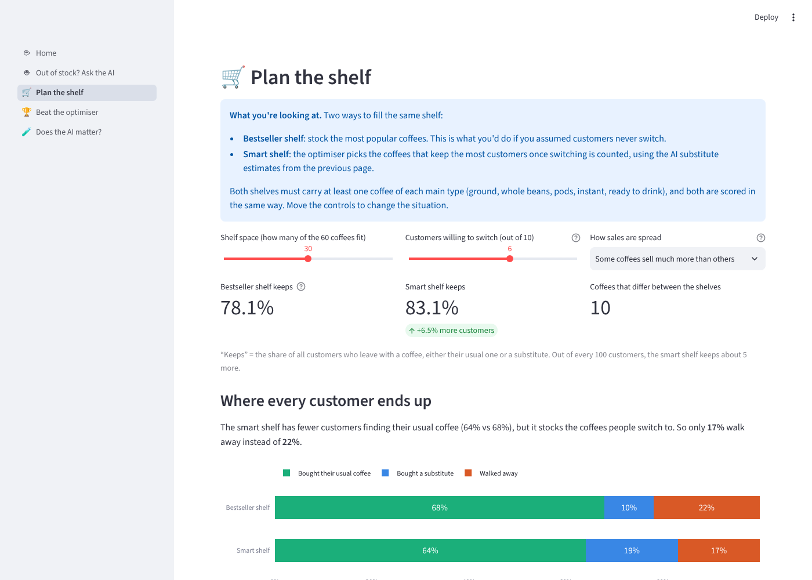
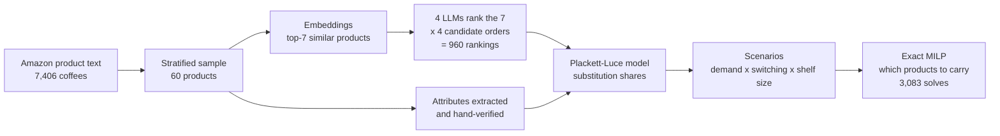
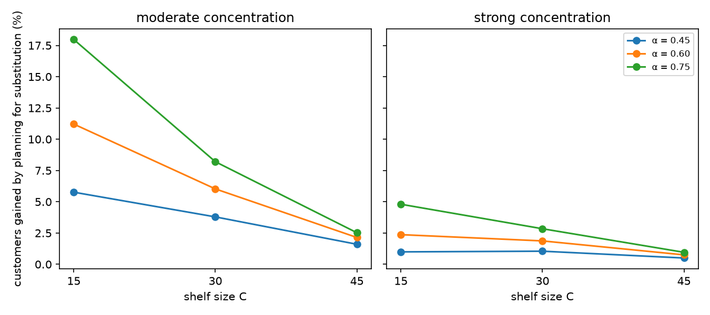
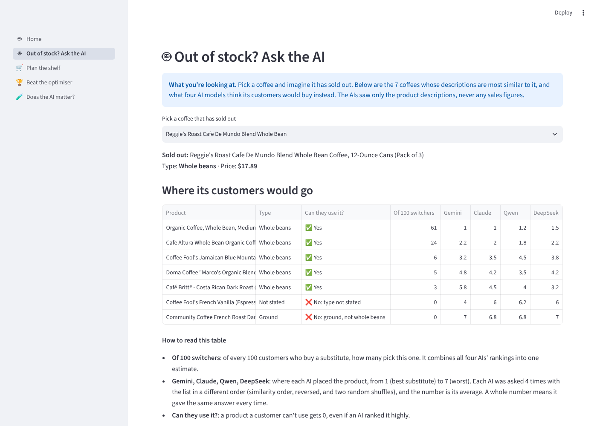

# LLM-Estimated Product Substitution for Assortment Planning

[](https://github.com/PJung88/llm-assortment-planning/actions/workflows/ci.yml)


**A retailer can stock 30 of 60 coffees. Which 30?** The answer depends on where customers go
when their usual product is missing, and for new products there is no sales history to tell
you. This project estimates that substitution behaviour from product descriptions alone, using
four large language models, and feeds it into an exact optimisation model that chooses the
shelf.

**[▶ Try the interactive demo](https://llm-assortment-planning.streamlit.app)** (no install needed)

<p align="center">
  
</p>

## Key results

Central scenario: 60 products, shelf for 30, 6 in 10 displaced customers willing to switch,
moderately concentrated demand (20 random demand patterns).

| Finding | Result |
|---|---|
| Planning for substitution vs. ignoring it | **+6.0% customers retained** (+0.5% to +18.0% across 18 scenarios; largest when the shelf is tight) |
| Does the choice of LLM matter? | **Little.** Any single LLM's plan is within 0.15-0.26% of the 4-model plan |
| LLM vs. plain text similarity | Embedding-similarity ranking alone: 1.08% worse, 4-7x the LLM gap |
| What matters most | The compatibility rules (e.g. no pods for a whole-bean buyer): switching them off costs 1.80% |
| How consistent are the LLMs? | Self-agreement across reshuffled candidate lists ranges from Kendall's tau 0.88 (Gemini) to 0.47 (DeepSeek); all four show position bias |

**What this does and does not show.** Demand is simulated, not observed. The 4-model plan is a
reference, not ground truth, so small regret against it means the LLMs agree, not that they are
right. The planning gain cannot be negative by construction, because both plans are judged under
the same substitution estimates. Details in [docs/METHODS.md](docs/METHODS.md#limitations).

## How it works



1. **Candidates.** Each product is treated as out of stock. Its 7 most similar products by
   text embedding (`bge-large-en-v1.5`) are the possible substitutes.
2. **LLM rankings.** Gemini, Claude, Qwen and DeepSeek each rank the 7 candidates as a
   shopper would, four times, with the list shuffled each time to expose position bias.
3. **Reliability analysis.** Self-consistency, position bias, cross-model agreement and
   rubric compliance, with bootstrap confidence intervals and simulated chance levels.
4. **Substitution shares.** A Plackett-Luce choice model turns the 16 rankings per product
   into "of 100 customers who switch, how many go to each candidate", after removing
   substitutes a customer could not use (wrong format or caffeine).
5. **Assortment optimisation.** A mixed-integer program chooses which products to carry to
   keep the most customers, under shelf-size and category-coverage constraints. It is
   linearised exactly and solved to proven optimality with CBC.

## Why the numbers can be trusted

- **Reproducible without API keys.** `python scripts/reproduce.py` re-runs Stages 07-10 from
  the saved LLM rankings in a temporary folder and compares every table with the committed
  results. Stages 07-09 reproduce to 1e-9 and run on every push in CI. Stage 10 reproduces every
  summary. In 15 of 2,583 solves a different machine's CBC returned a different shelf: 14 were
  exact ties, and one was a 0.05% better solution. Regret changed by less than 0.01 percentage
  points.
- **Every one of the 3,083 optimisation runs is checked.** CBC must report each solve optimal
  (gap 0), and its objective and every customer flow must match an independent evaluator. The
  MILP must also equal brute-force enumeration on random small instances. The run stops if any
  check fails.
- **Check the optimiser yourself.** `python scripts/hand_check.py` (or the demo's *Check it by
  hand* page) works through a 4-product example in exact fractions, shelf by shelf. Stage 10's own
  evaluator and MILP must agree with it. You can also pick 3-4 real products.
- **Attributes checked by hand.** The LLM-extracted product attributes used for the rules
  carry verbatim evidence quotes, and the decisive fields were manually verified for all 60
  products.
- **Tests** (`pytest`, under 10 seconds) cover the LLM-output parser, the Plackett-Luce fit, the
  choice model, and the consistency of the committed outputs. They also check that every number
  in this README matches the result files.

## Quickstart

```bash
git clone https://github.com/PJung88/llm-assortment-planning.git
cd llm-assortment-planning
pip install -r requirements.txt

pytest                                         # tests
python scripts/reproduce.py --stages 07 08 09  # re-run and compare, about 1 minute
python scripts/reproduce.py                    # include Stage 10 (25-60 minutes)
python scripts/hand_check.py                   # Stage 10 on 4 products, checkable by hand

pip install -r demo/requirements.txt
streamlit run demo/app.py                      # the interactive demo
```

Stages 01-06 (sampling, embeddings, LLM calls, attribute extraction) need the full Amazon file,
API keys and Ollama; see `requirements-llm.txt` and [data/README.md](data/README.md). Their
outputs are committed, so you don't need to re-run them.

## Repository layout

| Stage | Script (`src/pipeline/`) | Output (`outputs/`) |
|---|---|---|
| 01 Sample | `01_filter_and_sample.py` | `../data/processed/` |
| 02, 04b Model inputs | `02_export_model_inputs.py`, `04b_format_llm_inputs.py` | `../data/processed/` |
| 04 Embeddings | `04_embedding_score.py` | `embeddings/` |
| 05 LLM rankings | `05_ranking_elicit.py` | `rankings/raw_rankings.parquet` |
| 06 Attributes | `06_attribute_extract.py` | `attributes/` |
| 07 Ranking analysis | `07_ranking_analysis.py` | `analysis/` (report, tables, figures) |
| 08 Substitution shares | `08_substitution_shares.py` | `substitution/` |
| 09 Scenario inputs | `09_scenario_inputs.py` | `scenarios/` |
| 10 Assortment MILP | `10_assortment_experiment.py` | `assortment/` (report, tables, figures) |

Also: `demo/` (Streamlit app), `tests/`, `scripts/` (reproduction), `docs/METHODS.md`
(full design of every stage). All paths and parameters live in `src/config.py`.

**Stack:** Python, pandas, NumPy, SciPy, PuLP/CBC, sentence-transformers, Gemini and Anthropic
APIs, Ollama, Streamlit, Plotly, Matplotlib, pytest, GitHub Actions.

<details>
<summary><b>More results</b></summary>

**Regret against the 4-model plan, central scenario** (`outputs/assortment/summary_central.csv`)

| Substitution source | Customers lost vs 4-model plan | Products changed (of 30) |
|---|---|---|
| All 4 LLMs pooled (reference) | 0 | 0 |
| Qwen only | 0.15% | 1.9 |
| DeepSeek only | 0.15% | 1.9 |
| Claude only | 0.25% | 1.8 |
| Gemini only | 0.26% | 2.4 |
| LLM rankings, simple points rule | 0.49% | 3.2 |
| Embedding similarity only | 1.08% | 4.3 |

**LLM ranking reliability** (`outputs/analysis/analysis_report.txt`, 95% bootstrap CIs)

- Agreement across models: Kendall's W 0.81 (chance 0.25); all four pick the same top
  substitute for 47% of products.
- Position bias: a candidate shown one slot later is ranked about 0.10 places worse on average
  (DeepSeek 0.16, Gemini 0.04).
- Rule compliance: the top pick violates the format/caffeine rules in 6.5% (Gemini) to 14.7%
  (DeepSeek) of the cases where a compatible option existed.

<p align="center">
  
</p>
<p align="center">
  
</p>
</details>

## About

Master's thesis in Industrial Engineering, Lamar University (2026):
*Cold-Start Product Substitution Estimation for Assortment Planning Using Large Language Models*,
by Prashant Thapa.

The study design, modelling choices and analysis are my own. The code was written with AI
assistance (Claude) and checked by the tests, the reproduction script and the per-solve
verification described above.

This repository is a public snapshot of the thesis code (results frozen 8 October 2026). In the
original history, the 960 LLM rankings were committed on 22 September 2026, before the analysis
code that evaluates them (28 September). Comments were tidied for publication; the code is
otherwise identical to the thesis version.

Data: Amazon Reviews 2023 (Hou et al., 2024), used for research; see [data/README.md](data/README.md).
Code: MIT license.
